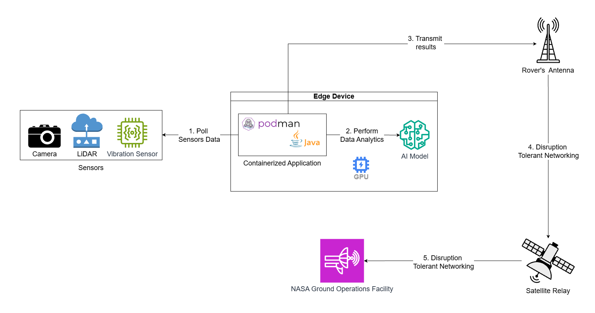

## Abstract

Under communication constraints and time-sensitive data processing, NASA lunar missions can require rovers to autonomously process data in real-time, as surface operations can encounter communication latency issues, limited bandwidth, and disrupted connectivity. For sustained lunar explorations, real-time data processing may prove critical, as ground-to-rover communication latency can compromise the mission. The following conceptual architectural proposal considers the prospect of an edge device attached to a hypothetical rover to reduce processing latency and potentially outperform ground-data processing.

## Introduction to Edge Computing

Edge computing serves as a distributed computing model and IT architecture that places applications, computing power services, and storage in closer proximity to the data source, managing how devices are placed across a network. This data is processed by a certain device, local computer, or server, as opposed to a designated data center. The computation in edge computing is either largely or entirely performed on distributed device nodes, where applications, devices, sensors, etc, operate locally. Edge computing applies to applications that must be closer to the source of the area where the nodes interact with the physical site. Although it may interact with a centralized cloud, edge computing does not require contact with a centralized cloud, as it performs local operations that apply to short-lived data. Specifically, edge computing acts on data at the source, usually at the first local computing node that processes sensor data, or the edge device, which can support low-latency data processing.

## Introduction to Containerized Application with Infused AI on Edge

A containerized application can be packaged with a runtime environment, AI model, and dependencies, such as libraries, binaries and configuration files, required for its operation. By integrating the components necessary to function independently, such an application can operate on a variety of infrastructures, including an edge device. In the proposed architecture, Podman serves as the container-management tool responsible for deploying and managing the container intended for running the Java application that interacts with the integrated AI. The Java application coordinates sensor-data acquisition, preprocessing, and result handling, while the AI model performs functional analysis. Depending on the model and design specifications, a GPU can serve as a means of accelerating suitable AI computation.

## Proposed Architecture

## Proposed Solution

Assuming NASA uses a hypothetical lunar rover vehicle for space exploration, deriving energy from solar power, the following apparatus can be considered. The lunar rover seeks to integrate antennas to facilitate the ground communication, with certain sensors including:

- Cameras to capture the images of terrain, rocks, and other objects
- LiDAR to provide 3D-mapping and hazard detection through laser imaging
- Vibration sensors to monitor rover health and detect potential obstructions

Effectively, the containerized application deployed in an edge device attached to the rover intends to poll any data captured by the sensors, leveraging the integrated AI model to analyze and process acquired data. Specifically, Java runtime application is deployed via Podman container to process data polled from the sensors. The application applies AI analytics to process data, with the GPU serving as a parallel-processing unit capable of expediting specific AI operative tasks in terrain classification. For instance, Java may read an image from the camera interface, preparing it in the format required for AI analysis. AI results can then be transferred back to Java for organization and potential future use. Podman containerization manages the application container, enabling consistent operation of the runtime environment. The final processed data can be transmitted to the ground operation facility via rover antennae, which can integrate satellite relay to communicate to the facility on earth. Disruption-Tolerant Networking can also apply a means of stable data transmission amidst intermittent communication links in a space environment by storing data in nodes for future relay when communication becomes available.

## Potential Simulation

In a future article, a Raspberry Pi apparatus is intended for quantitative simulation, where the mechanism can behave as a functional representation of an edge device. Bearing a potential for sensor utility, Java application, AI analysis via CPU and GPU for specific tasks, Podman containerization, and DTN software, the apparatus can operate as a rudimentary prototype for consideration.
